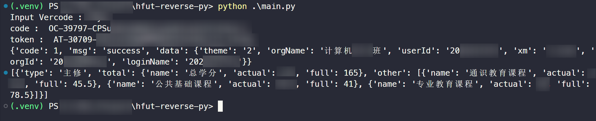

# 合肥工业大学 CAS 登录逆向

## 声明

本项目仅用于 **学习、研究和个人自动化** 目的，所有操作均在用户本地环境执行，本仓库不会收集或传输任何个人信息（如学号、密码等）。

请严格遵守学校及相关法律法规，切勿将本项目用于 **未经授权的商业或他人账户操作**。

作者对因使用本项目进行的任何违规行为 **不承担法律责任**。使用者须自行承担操作风险，并对自己的行为负责。

⚠️ 强烈建议仅在 **个人账户和自有设备** 上使用，避免在公共或他人设备上输入敏感信息。


## 这是什么

通过抓包分析登录逻辑，从而达到直接调用API完成登录合肥工业大学官网的作用。可以用于第三方软件开发。

## 目录结构

```
hfut-xc-login-reverse/
├── hfut/           # 客户端包
│   ├── config.py   # .env 账号读取 + 域名/URL 常量
│   ├── headers.py  # 各接口公共请求头构建器
│   └── client.py   # Reverse 类（CAS/门户/教务接口）
├── main.py         # 交互式 CLI 入口
├── vercode.py      # 独立验证码抓取工具
└── requirements.txt
```

## 如何使用

首先克隆并进入此仓库：

```bash
git clone https://github.com/Tuning-Luna/hfut-xc-login-reverse.git
cd hfut-xc-login-reverse
```


安装依赖项

```bash
python -m pip install -r requirements.txt -i https://pypi.tuna.tsinghua.edu.cn/simple
```


在项目根目录（`main.py` 同级）创建 `.env` 文件，可参考 `.env.example` 填写学号、密码。`.env.example` 只是模板，不会被程序自动加载。凭据用于向学校 CAS 服务发起认证，请勿提交或分享真实的 `.env` 文件。

```env
student_id="202xxxxxxx"
password="YourPassword"
```

也可以设置同名环境变量 `student_id` 和 `password`；已有环境变量优先于 `.env`。修改配置后，需要退出并重新启动程序才能生效。

程序会在开始新的验证码登录流程前检查配置是否缺失。若提示缺少 `LOGIN_FLAVORING`，则是登录初始化未取得加密密钥，应检查初始化接口响应，而不是反复修改密码或验证码。


运行[main.py](./main.py)文件 :

```bash
python main.py
```


然后会调用系统看图工具打开验证码，在终端正确的输入验证码即可（OCR未找到合适模型，暂时手动输入）


你会在终端看到你的敏感信息，比如姓名，培养情况等（这些信息来自你登录后的官方接口，本仓库不会保存或外传），这就意味着登录成功。如下图所示：

其它 CAS 统一身份认证后的服务接口，你可以根据自己的需求继续调用。请自行体会或者问LLM，或者提Issue，看到了我会回复。

## 回归测试

安装运行依赖后，可使用 Python 标准库运行测试，无需真实账号或联网登录：

```bash
python -m unittest discover -s tests -v
```

